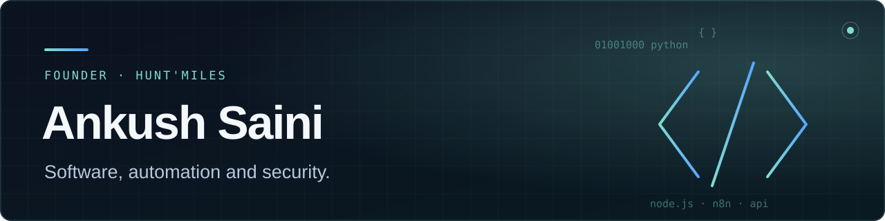
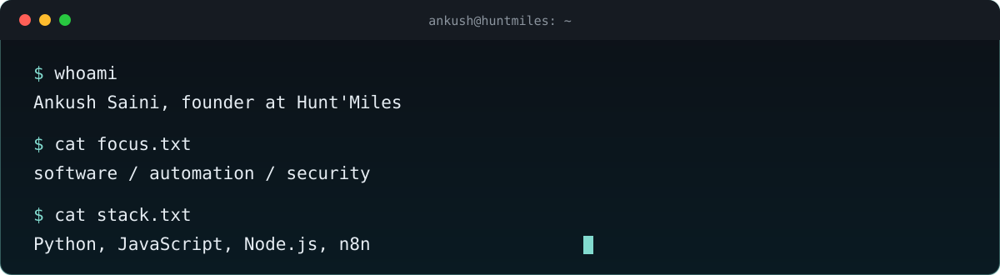

  

  

I'm Ankush, founder of [Hunt'Miles](https://huntmiles.com), where I'm building a company that takes day-to-day operational work off the owners of traditional Indian businesses, so they can focus on growing. We're starting in Delhi NCR.

My technical background is software and product engineering, with a focus on cybersecurity and compliance. I build API-connected workflow automations with n8n and Python, and I write web apps in JavaScript and Node.js.

### `> projects`

#### AI-Powered Cyber Security Penetration Testing System `[in development]`
An AI-assisted platform for automating **authorized** security assessment workflows: analyzing vulnerabilities, prioritizing findings and generating actionable security reports. Work in progress, not public yet.

#### [Social Community Moderator](https://github.com/ankushsaini04/Social-Community-Moderator-) `[public repo]`
A community moderation project for assisting with content review and identifying potentially inappropriate content, with role-based dashboards and real-time updates.

#### [Weatherworld](https://github.com/ankushsaini04/Weather-application) `[public repo]`
A weather app for looking up current conditions and exploring hourly and weekly forecasts.

#### Workflow Automation with n8n `[not public]`
Workflow automation that integrates multiple APIs to reduce repetitive manual tasks.

#### Cybersecurity Simulation Tool `[educational]`
A Python-based keylogger built for educational security testing in controlled environments.

### `> experience`

- **Founder, Hunt'Miles**, Oct 2026 to present
- **Software Developer & Product Engineer Intern, Cognoshift**, Apr 2026 to Oct 2026. Product development for a compliance-security company, including DPDP and CERT-In use cases.
- **Cybersecurity Intern, IT4T Solutions**, Jun 2025 to Aug 2025. Security testing and attack simulation in controlled environments.
- **Python Development Intern, IT4T Solutions**, Jul 2024 to Aug 2024. Python automation scripts for backend processes, Git and code reviews.
- **Web Development Intern, Mockvel Pvt Ltd**, Jun 2024 to Jul 2024. Backend work with Node.js, Django and PHP.

### `> stack`

- **Languages:** Python, JavaScript, Java
- **Web and backend:** Node.js, React, Django, PHP, HTML, CSS, Tailwind CSS
- **Automation and APIs:** n8n, Postman, API integration, Git
- **Security:** threat analysis, security testing, attack simulation, DPDP and CERT-In compliance basics

---

[Hunt'Miles](https://huntmiles.com) · [LinkedIn](https://www.linkedin.com/in/ankush-saini4) · [Portfolio](https://ankush-saini-portfolio.vercel.app) · [Repositories](https://github.com/ankushsaini04?tab=repositories)
